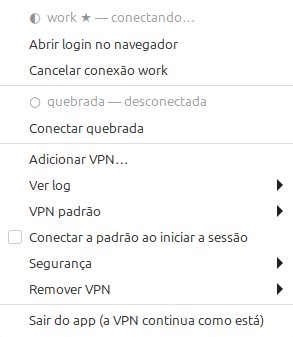
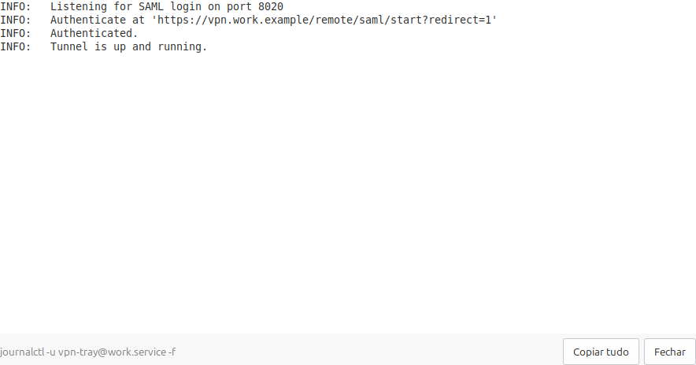
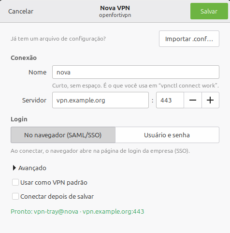
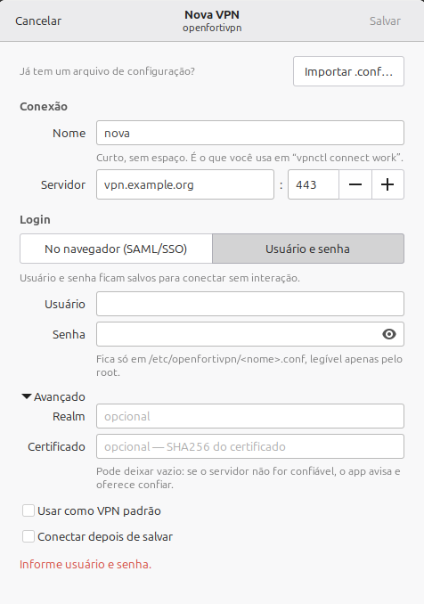

# VPN Tray

Ícone na bandeja do sistema, CLI e servidor MCP para usar o [openfortivpn](https://github.com/adrienverge/openfortivpn) no Linux, com login SAML/SSO pelo navegador, conexão como serviço do systemd e uma camada opcional de senha ao conectar.

[](https://github.com/eliasrosa/vpn-tray/actions/workflows/ci.yml)
[](https://github.com/semantic-release/semantic-release)
[](LICENSE)



> Projeto independente. Não tem relação com a Fortinet. FortiGate e FortiClient são marcas da Fortinet, Inc.

## Recursos

- **Ícone ao lado do relógio** (XApp/Cinnamon; AyatanaAppIndicator como alternativa).

  |  |  |  |  |
  |:-:|:-:|:-:|:-:|
  | desconectada | conectando ou aguardando login | conectada | erro |

  Qualquer clique só abre o menu. Conectar e desconectar são sempre itens do menu, então um clique sem querer não derruba a VPN.
- **SAML/SSO:** o navegador abre sozinho na página de login, inclusive quando a conexão começa pela CLI ou por um agente.
- **Conexão como serviço** (`vpn-tray@<perfil>.service`): sair do app não derruba a VPN.
- **Várias VPNs**, com uma padrão (★), opção de conectar ao iniciar a sessão e log ao vivo numa janela do próprio app.
- **Adicionar VPN** por formulário, com validação ao vivo e importação de `.conf` do openfortivpn.
- **Certificado desconhecido:** o app mostra o SHA256 e oferece confiar e reconectar.
- **`vpnctl`**: CLI com saída `--json` e códigos de saída previsíveis.
- **Servidor MCP e skill** para agentes (Claude Code, Kiro e outros clientes MCP). Os agentes consultam o status e conectam só com a sua confirmação.
- **Segurança em camadas:** regra do polkit restrita ao seu usuário, opção de pedir senha a cada conexão, e helper root que só grava campos conhecidos.

| Ver log | Nova VPN (SAML) | Nova VPN (usuário e senha) |
|---|---|---|
|  |  |  |

## Requisitos

- Linux com systemd e polkit (testado no Linux Mint 22 com Cinnamon).
- [openfortivpn](https://github.com/adrienverge/openfortivpn) 1.21 ou mais novo (`--saml-login`).
- Python 3.10 ou mais novo com PyGObject: `python3-gi`, `gir1.2-gtk-3.0`, `gir1.2-notify-0.7` e `gir1.2-xapp-1.0` (ou `gir1.2-ayatanaappindicator3-0.1`).
- `node`, só para rodar o teste da regra do polkit.

## Instalar

```bash
git clone https://github.com/eliasrosa/vpn-tray.git
cd vpn-tray
./install.sh
```

O `install.sh` pede `sudo` uma vez, para:
- instalar a unit `vpn-tray@.service` (apontando para o `openfortivpn` que estiver no `PATH`) e o helper em `/usr/local/libexec/vpn-tray/`;
- gerar a regra do polkit a partir da política.

Ele também:
- transforma cada `/etc/openfortivpn/<nome>.conf` que já existir num perfil (SAML se o arquivo não tiver `password`);
- põe o ícone no autostart e instala `vpn-tray` e `vpnctl` em `~/.local/bin`;
- registra o MCP e a skill nos agentes que encontrar. Para pular essa parte: `./install.sh --no-agents`.

Para desinstalar, rode `./uninstall.sh`. Os perfis em `/etc/openfortivpn` são mantidos.

## Como funciona

```text
ícone / vpnctl / MCP ──systemctl──▶ vpn-tray@<nome>.service ──▶ openfortivpn -c /etc/openfortivpn/<nome>.conf
        │                                   │
        └────────── journal ◀───────────────┘   (login SAML, túnel no ar, certificado, erros)
```

- **Perfil `<nome>`:**
  - `/etc/openfortivpn/<nome>.conf` (0600, só o root lê): host, porta, usuário/senha, realm e trusted-cert.
  - `/etc/openfortivpn/<nome>.args` (0644, sem segredos): diz à unit e ao app se o login é SAML.
- **Adicionar ou remover perfil, confiar em certificado e mudar a política** passam por `pkexec` e pelo helper, que pede senha.
- **Configuração do usuário** fica em `~/.config/vpn-tray/settings.json`: VPN padrão, conectar ao iniciar a sessão e permissões dos agentes.

## CLI: `vpnctl`

```bash
vpnctl status
vpnctl connect [nome]
vpnctl disconnect [nome]
vpnctl logs [nome] -f
vpnctl import arquivo.conf
vpnctl policy require-password on
vpnctl agents allow-connect off
vpnctl --version
```

- `vpnctl status`: estado de cada VPN, VPN padrão, política e permissões.
- `vpnctl connect [nome]`: conecta (a padrão, se omitir o nome) e espera subir.
- `vpnctl disconnect [nome]`: desconecta (a ativa, se omitir o nome).
- `vpnctl logs [nome] -f`: log do serviço.
- `vpnctl import arquivo.conf`: converte um `.conf` do openfortivpn em perfil.
- `vpnctl policy require-password on`: passa a pedir senha a cada conexão.
- `vpnctl agents allow-connect off`: proíbe os agentes de conectar.

Todos os comandos aceitam `--json`. Códigos de saída: 0 ok, 1 erro, 2 uso, 4 a VPN não subiu.

**Escopo: só VPN.** O VPN Tray diz se a VPN está no ar e conecta ou desconecta. Testar banco, API ou outro serviço fica com a ferramenta de cada um.

## Agentes (MCP + skill)

`vpnctl mcp` é um servidor MCP via stdio, sem dependências. `vpnctl setup-agents` registra o servidor e a skill ([`agent/SKILL.md`](agent/SKILL.md)):

- **Claude Code:** `claude mcp add -s user`, mais `~/.claude/skills/vpn-tray`.
- **Kiro:** `~/.kiro/settings/mcp.json`, mais `~/.kiro/skills/vpn-tray`.

Use `--dry-run` para ver o que mudaria e `--remove` para desfazer. Para outro cliente MCP, configure o comando `vpnctl` com o argumento `mcp`.

| Ferramenta | O que faz | Confirmação |
|---|---|---|
| `vpn_status` | estado de cada VPN e política | não |
| `vpn_logs` | log para diagnóstico | não |
| `vpn_connect` | conecta e espera subir | `user_confirmed=true` |
| `vpn_disconnect` | desconecta | `user_confirmed=true` |

Fluxo da skill:
1. Consulta `vpn_status`.
2. Se a VPN estiver desligada, pergunta ao usuário se pode conectar.
3. Com o sim, roda `vpn_connect` e depois `vpn_status`.
4. Segue a tarefa com a ferramenta própria (por exemplo, o MCP do banco).

## Segurança

São três camadas, da mais forte para a mais fraca.

1. **Pedir senha ao conectar** (polkit): menu → Segurança, ou `vpnctl policy require-password on`.
   - Qualquer conexão (ícone, CLI, agente ou `systemctl` direto) abre a caixinha de senha do sistema.
   - Desconectar continua livre.
   - Mudar a política, nos dois sentidos, pede senha de administrador, então um agente não desliga a trava sozinho.
2. **Permissões dos agentes** (`agents.enabled`, `allow_connect`, `allow_disconnect`).
   - O MCP respeita essas permissões.
   - São preferência, não trava: quem acessa o seu `$HOME` consegue editá-las.
3. **Confirmação:** o MCP recusa conectar ou desconectar sem `user_confirmed=true`.

Além disso:
- a regra do polkit só vale para o seu usuário, numa sessão local e ativa, e só para start, stop e restart de `vpn-tray@*`;
- o helper root valida nome, host, porta e hash, recusa quebras de linha e nunca grava chaves como `pppd-plugin`.

Para reportar uma vulnerabilidade, veja [SECURITY.md](SECURITY.md).

## Desenvolvimento

```bash
python3 -m pytest -q tests
python3 tests/visual_snapshots.py
./vpn_tray.py --demo
```

- **Testes:** mais de 70, e nenhum toca na VPN real nem no sistema.
- **Teste visual:** gera prints do menu, do log e do formulário em `tests/snapshots/`, que fica fora do git.
- **Modo demo:** VPNs de mentira; a "quebrada" simula o erro de certificado.

O versionamento é semântico e automático: os commits seguem [Conventional Commits](https://www.conventionalcommits.org/), e o [semantic-release](https://github.com/semantic-release/semantic-release) gera a versão, o [CHANGELOG](CHANGELOG.md) e a release no GitHub a cada push na `main`. Veja [CONTRIBUTING.md](CONTRIBUTING.md).

## Créditos

- **[openfortivpn](https://github.com/adrienverge/openfortivpn)** (GPL-3.0): o cliente que faz a VPN de verdade. O VPN Tray é só uma interface por cima e chama o binário instalado no sistema, sem incluir código dele.
- **[openfortigui](https://github.com/theinvisible/openfortigui)** (GPL-3.0): GUI para o openfortivpn que serviu de inspiração.

## Licença

[MIT](LICENSE).
