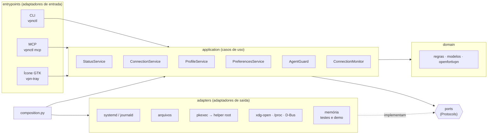
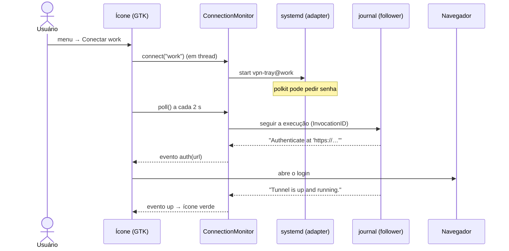

# Arquitetura

O VPN Tray segue a **arquitetura hexagonal** (portas e adaptadores):
- as regras de negócio não sabem que existem GTK, systemd ou terminal;
- quem fala com o mundo são os adaptadores, plugados por contratos (portas).

## Camadas

| Camada | Pasta | Pode depender de | Contém |
|---|---|---|---|
| Domínio | `vpntray/domain/` | só stdlib (sem I/O) | estados, validação de perfil, leitura do log e do `.conf` do openfortivpn |
| Portas | `vpntray/ports.py` | domínio | contratos (`Protocol`): `ServiceManager`, `Journal`, `JournalFollower`, `ProfileRepository`, `ProfileAdmin`, `SettingsRepository`, `PolicyReader`, `Browser`, `NetworkProbe`, `Clock` |
| Aplicação | `vpntray/application/` | domínio, portas | casos de uso e erros |
| Adaptadores | `vpntray/adapters/` | domínio, portas, `application.errors` | systemd, arquivos, pkexec, área de trabalho, configuração dos agentes e o **sistema em memória** |
| Entrada | `vpntray/entrypoints/` | tudo, via `composition` | `cli.py`, `mcp.py`, `tray/` (GTK) |
| Composição | `vpntray/composition.py` | tudo | `build()` monta o sistema real; `build_memory()` monta o de memória |

O arquivo `tests/test_architecture.py` **reprova o build** se:
- uma camada importar o que não deve;
- algo fora de `entrypoints/tray` importar GTK;
- o domínio fizer I/O.

## Casos de uso

| Caso de uso | Quem usa | O que faz |
|---|---|---|
| `StatusService` | CLI, MCP | retrato das VPNs a partir do systemd e do log de cada execução |
| `ConnectionService` | CLI, MCP | conectar (derrubando outra), esperar subir, avisar o login SAML; desconectar |
| `ConnectionMonitor` | ícone | acompanhar ao vivo e emitir eventos (`auth`, `cert`, `up`, `failed`, `down`), sem GTK |
| `ProfileService` | ícone, CLI | validar, cadastrar, importar, remover e confiar em certificado |
| `PreferencesService` | ícone, CLI | VPN padrão, autoconnect, permissões dos agentes e política |
| `AgentGuard` | MCP | regras para agentes (habilitado, permissões, confirmação) |

## Fluxo: conectar uma VPN SAML pelo ícone

## Decisões

- **O helper root fica fora do pacote.** Ele roda como root via `pkexec` e não pode importar código de uma pasta que o usuário edita. A validação existe nele e no domínio; `tests/test_contract_helper.py` garante que os dois concordam.
- **Sem dependências Python de terceiros.** Só stdlib e PyGObject, que vem do sistema. O MCP implementa o JSON-RPC na mão (são poucas mensagens).
- **O monitor é síncrono e sem GTK.** Quem chama `poll()` é o laço do GTK; nos testes é o próprio teste. Ações que podem bloquear (a senha do polkit) rodam por um *runner* injetável: thread no app real, síncrono nos testes e no demo.
- **O sistema em memória implementa todas as portas.** Testes rápidos (quase 200, em cerca de 1,5 s) e o modo `--demo` usam a mesma simulação.
