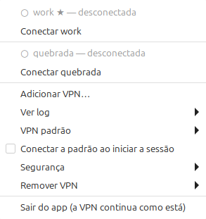
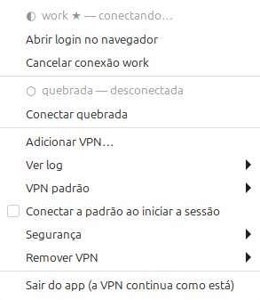
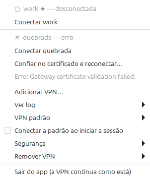
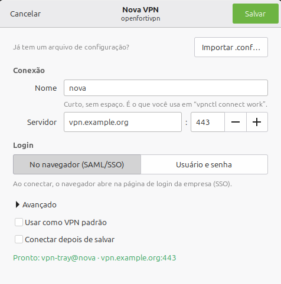
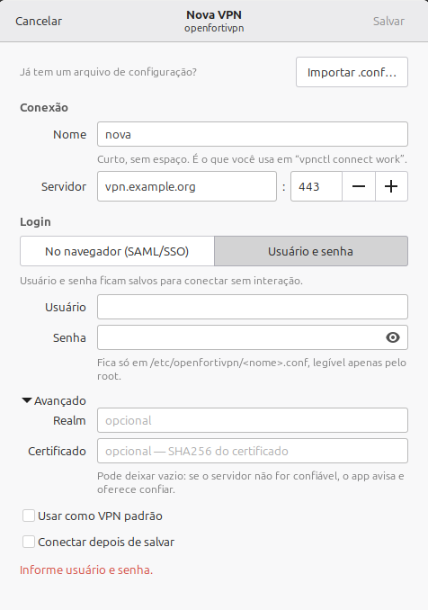
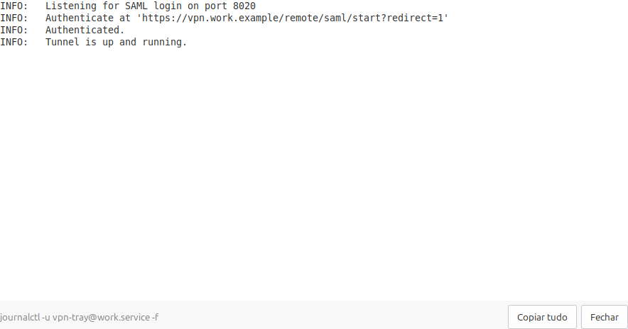

# Uso do ícone

## Estados

| | Estado | O que significa |
|:-:|---|---|
|  | desconectada | nenhuma VPN no ar |
|  | conectando | subindo a conexão ou aguardando o login no navegador |
|  | conectada | túnel no ar |
|  | erro | a última conexão falhou; o erro aparece no menu |

Passe o mouse sobre o ícone para ver um resumo no tooltip.

## Menu

**Qualquer clique (esquerdo ou direito) só abre o menu.** Conectar, desconectar e cancelar são sempre itens do menu, então um clique sem querer não derruba a VPN nem abre o navegador.

| Desconectada | Aguardando login | Erro de certificado |
|---|---|---|
|  |  |  |

Para cada VPN, o menu mostra o estado (a padrão tem ★) e a ação que faz sentido no momento:

| Estado | Ação no menu |
|---|---|
| desligada | **Conectar** |
| conectada | **Desconectar** |
| conectando | **Abrir login no navegador** e **Cancelar conexão** |
| certificado não confiável | **Confiar no certificado e reconectar…** |

O resto do menu:
- **Adicionar VPN…**
- **Ver log**: abre o journal ao vivo numa janela do app.
- **VPN padrão**: aparece quando há mais de uma VPN.
- **Conectar a padrão ao iniciar a sessão**.
- **Segurança**: veja [security.md](security.md).
- **Remover VPN**.
- **Sair do app**: a VPN continua no estado em que está.

Só uma VPN fica conectada por vez: conectar outra desconecta a atual.

## Login SAML/SSO

Ao conectar uma VPN SAML, o navegador abre sozinho na página de login da empresa. Termine o login lá; o ícone fica verde quando o túnel sobe. O navegador abre também quando a conexão é iniciada pela CLI ou por um agente, se o ícone estiver rodando.

## Nova VPN

| SAML | Usuário e senha |
|---|---|
|  |  |

- **Nome**: curto, sem espaço (letras minúsculas, números, `-` e `_`). É o nome usado em `vpnctl connect <nome>`.
- **Login**:
  - **No navegador (SAML/SSO)**: não guarda senha.
  - **Usuário e senha**: a senha fica só em `/etc/openfortivpn/<nome>.conf`, que apenas o root lê.
- **Avançado**: realm e certificado (`trusted-cert`). Pode deixar vazio, porque se o certificado não for confiável o app avisa e oferece confiar.
- **Importar .conf…**: preenche o formulário a partir de um arquivo do openfortivpn. Opções que o VPN Tray não grava (como `pppd-plugin`) são ignoradas e listadas.
- **Validação ao vivo**: o botão "Salvar" só habilita quando está tudo certo.

Salvar pede a sua senha, porque grava em `/etc`.

## Certificado não confiável

Se o servidor apresentar um certificado que não está na lista de confiança, a conexão falha, o ícone fica vermelho e o menu oferece **Confiar no certificado e reconectar…**. A janela mostra o SHA256: só confirme se você esperava esse servidor, por exemplo comparando com o hash que o time de infra passou.

## Log

**Ver log → \<VPN>** abre o journal da unit ao vivo, com "Copiar tudo". O equivalente no terminal é `vpnctl logs <nome> -f`.
